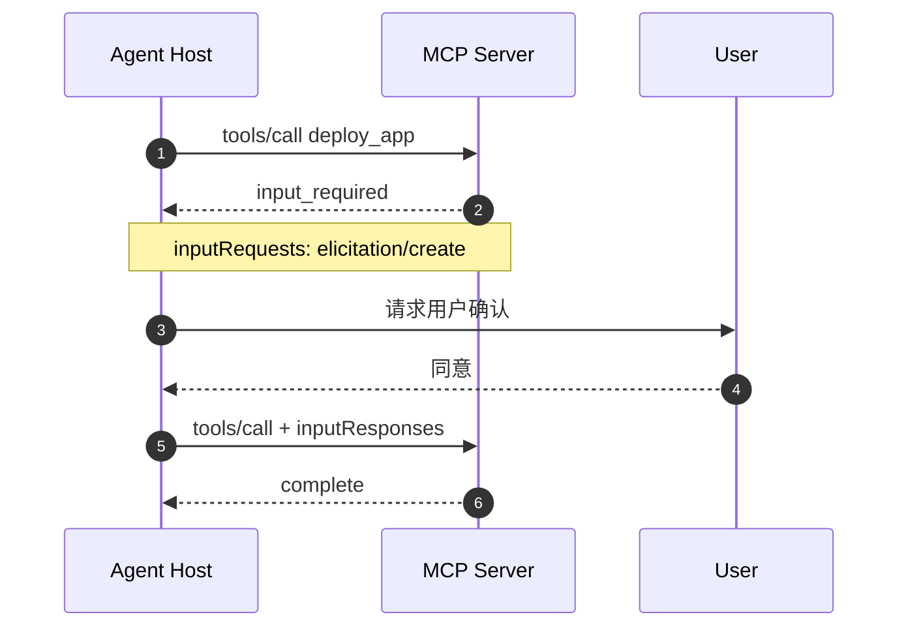

## 概念定位

MCP，Model Context Protocol 模型上下文协议，旨在提供一个 **标准化** 的协议，让大型语言模型（LLM）能够安全、统一地连接外部数据源和工具。


- **跨版本**：Host / Client / Server、三大原语、工具调用主链路 —— 概念仍通用。
- **生命周期**：握手时代和无状态时代


## 核心架构（跨版本通用）

1. MCP Host (宿主应用)：发起请求的 AI 应用，负责把工具清单交给模型、把执行结果回填给模型。
2. MCP Client (客户端)：主机内的连接器，负责与服务器通信，与 MCP Server 保持一对一连接。
3. MCP Server (服务器)：通过标准协议暴露数据（资源）或功能（工具）的轻量级服务。

```text
              ┌──────── Host（Cursor 等）────────┐
              │                                  │
              │   LLM                            │
              │    │  工具清单 / 调用结果         │
              │    ▼                             │
              │   编排（审批、转发）              │
              │    │            │                │
              │ Client₁      Client₂             │
              └───┬──────────────┬───────────────┘
                  │ JSON-RPC     │ JSON-RPC
                  ▼              ▼
              Server₁        Server₂
              文件系统       GitHub / 数据库 …
```


## 三大核心原语 primitive（跨版本通用）

Server 对外暴露能力时，主要就这三类。核心差别不在「叫什么」，而在 **谁发起**：

| 原语      | 谁控制       | 用途                                              |
| --------- | ------------ | ------------------------------------------------- |
| Tools     | 模型决定调用 | 可执行函数（查库、调 API），类似 function calling |
| Resources | 应用决定读取 | 只读数据（文件内容、数据库记录），类似 GET 请求   |
| Prompts   | 用户主动触发 | 预置的提示词模板（如 /斜杠命令）                  |


Tool 是可执行能力，调用方法是tool/call。定义格式是标准 JSON Schema：

```jsonc
{
  "name": "get_issue",
  "description": "Get issue details",
  "inputSchema": {
    "type": "object",
    "properties": {
      "issue_id": {
        "type": "integer"
      }
    },
    "required": ["issue_id"]
  },
  "outputSchema": {
    "type": "object",
    "properties": {
      "title": { "type": "string" },
      "status": { "type": "string" }
    },
    "required": ["title", "status"]
  }
}
```

成功结果通常包含 content，也可以包含 structuredContent。
```json
{
  "jsonrpc": "2.0",
  "id": 2,
  "result": {
    "resultType": "complete",
    "structuredContent": {
      "title": "Fix login bug",
      "status": "open"
    },
    "isError": false
  }
}
```

新版的 `structuredContent` 支持符合 `outputSchema`的 JSON 值，包括对象、数组及标量类型。

另外，要区分两种错误：
- JSON-RPC `error`：协议层错误，例如未知 Tool 或错误的请求结构。
- Tool Result 中的 `isError: true`：工具执行错误，例如业务参数不合法、外部 API 调用失败。
后者更适合反馈给 Model，让它尝试自行修正

## transport（跨版本通用）

所有消息都是 **JSON-RPC 2.0**。传输层演进：

| 传输                | 出现 / 状态                                               | 说明                                        |
| ------------------- | --------------------------------------------------------- | ------------------------------------------- |
| **stdio**           | 一直存在                                                  | Host 把 Server 当本地子进程，走标准输入输出 |
| **HTTP+SSE**        | `2024-11-05`；自 `2025-03-26` 起被取代，现 **Deprecated** | 旧远程方案，新实现勿再采用                  |
| **Streamable HTTP** | `2025-03-26` 引入；`2026-07-28` 行为再变                  | 当前远程主流                                |

JSON-RPC 三种消息形态（跨版本通用）：

```jsonc
// 请求（有 id，需要回复）
{
  "jsonrpc": "2.0",
  "id": 1,
  "method": "tools/call",
  "params": { "name": "start_stream", "arguments": { "title": "前端专场" } }
}

// 响应（成功给 result，失败给 error）
{
  "jsonrpc": "2.0",
  "id": 1,
  "result": {
    "content": [{ "type": "text", "text": "直播已开启" }],
    "isError": false
  }
}

// 握手收尾通知示例（仅握手时代；无 id，Server 不必回复）
{ "jsonrpc": "2.0", "method": "notifications/initialized" }
```

## 生命周期

- Legacy MCP（2025-11-25 及更早）：初始化握手 → 正常运行 → 关闭连接。
- Modern MCP（2026-07-28）：按请求声明协议版本和能力，不再依赖握手或协议级 Session，可选择先执行 server/discover。
### 握手生命周期

连接建立时先握手、**协商能力**（如 Server 声明支持 tools 但不支持 resources），协议版本不匹配则降级或断开：

```text
Client                          Server
  │── initialize（协议版本 + 自身能力）──▶│
  │◀─── initialize result（能力协商）────│
  │── notification: initialized ────────▶│
  │                                       │
  │── tools/list / tools/call 等 ───────▶│  ← 正常工作阶段
  │◀──── result / notification ──────────│
```


### 无状态时代

#### 无握手工作流

```text
Client                              Server
  │──（可选）server/discover ──────────▶│  查支持的版本 / 能力 / 身份
  │◀── discover result ────────────────│
  │                                    │
  │── 任意 RPC（每请求带 _meta 版本）──▶│  可直接打，不必先 discover
  │◀── result（含 resultType）─────────│
  │                                    │
  │──（可选）subscriptions/listen ────▶│  长流：list 变更等通知
```
***Step 1：可选的 Discovery***

新版新增：`server/discover`
它的用途是获知 Server 的协议版本、能力和实现信息，而不是建立一个有状态的 Session。

例如：
```json
{
  "jsonrpc": "2.0",
  "id": 1,
  "method": "server/discover",
  "params": {
    "_meta": {
      "io.modelcontextprotocol/protocolVersion": "2026-07-28",
      "io.modelcontextprotocol/clientInfo": {
        "name": "my-agent",
        "version": "1.0.0"
      },
      "io.modelcontextprotocol/clientCapabilities": {}
    }
  }
}
```
Server 可以返回：
```json
{
  "jsonrpc": "2.0",
  "id": 1,
  "result": {
    "resultType": "complete",
    "supportedVersions": ["2026-07-28"],
    "capabilities": {
      "tools": {},
      "resources": {}
    },
    "ttlMs": 3600000,
    "cacheScope": "public"
  }
}
```
要特别注意：
- Server 必须实现 server/discover。
- Client 可以不调用 server/discover。
- Client 可以直接发送 tools/call 等请求。
- 如果协议版本不支持，Server 可以返回 UnsupportedProtocolVersionError，Client 再选择兼容版本重试。
这是一种按请求声明版本的机制，不再是初始化时的一次性版本协商。

***Step 2：每次请求带 `_meta`***

新版中，每次请求需要包含自己的协议元数据。

例如：
```json
{
  "jsonrpc": "2.0",
  "id": 2,
  "method": "tools/call",
  "params": {
    "name": "get_issue",
    "arguments": {
      "issue_id": 123
    },
    "_meta": {
      "io.modelcontextprotocol/protocolVersion": "2026-07-28",
      "io.modelcontextprotocol/clientInfo": {
        "name": "my-agent",
        "version": "1.0.0"
      },
      "io.modelcontextprotocol/clientCapabilities": {}
    }
  }
}
```
其中，protocolVersion 和 clientCapabilities 是必需的请求元数据；clientInfo 推荐提供，但不是绝对必需。

Server 不需要记住前一次请求的握手信息，就可以独立处理当前请求。

***Step 3：Server 独立处理***

Server 需要完成：

版本校验 → 能力校验 → 权限校验 → 参数验证 → 执行 → 返回响应。

这是对典型实现路径的工程化概括，不表示 MCP 规范强制规定这几个内部函数必须按照该顺序实现。

***Step 4：请求结束与资源清理***

新版去掉了协议级 Session，但并没有删除底层 Transport 或 Server 进程。

例如一个 stdio Server 仍然可以持续运行，接收多个互不相关的请求。

需要结束时，仍然通过关闭输入流、退出进程等 Transport 机制处理；HTTP 则处理请求、响应流的结束和取消。

无协议级 Session ≠ 无连接 ≠ 无进程 ≠ 无业务状态。

### 新旧生命周期核心对比

| 维度 | Legacy 2025-11-25 | Modern 2026-07-28 |
| :--- | :--- | :--- |
| 启动握手 | `initialize` | 不需要 |
| 完成通知 | `notifications/initialized` | 不需要 |
| 能力发现 | 初始化时交换 | `server/discover` |
| 版本信息 | Session 内协商 | 每次 Request 声明 |
| 协议 Session | 有 | 移除 |
| Server 主动请求 | 可发 JSON-RPC Request | 改为 MRTR |
| 变更通知 | 旧订阅或连接流机制 | `subscriptions/listen` |
| HTTP Session ID | `Mcp-Session-Id` 可使用 | 已移除 |
| 长任务 | 旧实验性 Tasks 机制 | Tasks Extension |
| Server 状态 | 可依赖协议 Session | 使用显式业务 Handle |


## MCP 的消息类型

MCP 的消息基于 JSON-RPC 2.0。

主要有三类：

| 消息类型 | 主要字段 | 含义 |
| :--- | :--- | :--- |
| `Request` | `jsonrpc`, `id`, `method`, `params` | 发起操作 |
| `Response` | `jsonrpc`, `id`, `result` 或 `error` | 回答请求 |
| `Notification` | `jsonrpc`, `method`, `params` | 单向通知，无响应 |

id 用来关联请求与响应；Notification 不包含 id。

### Request / Response

最基本的模式。
Client ── tools/call ──> Server
Client <── Result ───── Server


请求期间还可以收到与该请求相关的 Progress Notification。

### MRTR：多轮往返请求

MRTR（Multi Round-Trip Requests）是 Modern MCP 的一个重要变化。

场景：Agent 调用 deploy_app，Server 发现还需要用户确认。


### Subscribe / Notify
这是处理长期变化通知的模式。

例如，一个 MCP Server 的 Tool 列表发生变化。

Client 可以调用：

`subscriptions/listen`，声明希望监听 `toolsListChanged` 等事件。

Server 之后通过对应的订阅流发送：`notifications/tools/list_changed`

Client 再重新获取 `tools/list`。

它不是在每次调用 Tool 后自动建立的连接，而是一项由 Client 主动选择的订阅机制。订阅状态依附于该订阅请求，而非一个全局协议 Session。

## 一次工具调用（Host 视角，跨版本）

协议开场方式变了，但 Host 侧业务链路仍是：

1. Host 通过 `tools/list` 拿到工具清单（名称 + 描述 + JSON Schema）。
2. Host 把工具定义注入模型上下文（本质是拼进 system prompt）。
3. 模型决定调用某个工具，输出结构化调用请求。
4. Host 通过 Client 以 `tools/call` 发 JSON-RPC 给 Server（模型不直接接触 Server）。
5. Server 返回结果，Host 回填给模型，模型继续生成。

差别只在第 1/4 步前后：握手时代要先 `initialize`；`2026-07-28` 则每请求带版本，或先 `server/discover`。

## 安全机制（跨版本 + 新规范补强）

- **用户确认**：敏感工具在真正调用前，Host 可弹窗审批。
- **架构隔离**：模型永远不直接接触 Server，所有调用经 Host 转发。
- **能力最小暴露**：旧版靠握手协商；新版靠每请求 capabilities + `server/discover`，未声明的能力客户端看不到。
- **远程认证**：Streamable HTTP 用 `Authorization` 等头或 OAuth；`2026-07-28` 加强 issuer 校验，并推动 CIMD。
- **注入风险**：工具 name/description 会进模型上下文 → **tool poisoning** / **rug pull**。对策：只接可信 Server、更新前审阅工具变更。


Host 侧通过 `mcpServers` 配置接入（示意，具体字段以所用 Host 为准）：

```jsonc
{
  "mcpServers": {
    "filesystem": {
      // 本地：stdio
      "command": "npx",
      "args": ["-y", "@modelcontextprotocol/server-filesystem", "/path/to/dir"]
    },
    "my-remote": {
      // 远程：Streamable HTTP
      "url": "https://example.com/mcp",
      "headers": { "Authorization": "Bearer xxx" }
    }
  }
}
```

配置后 Host 常会给工具加 `mcp__服务器名__工具名` 前缀，例如 `mcp__node_repl__js`。