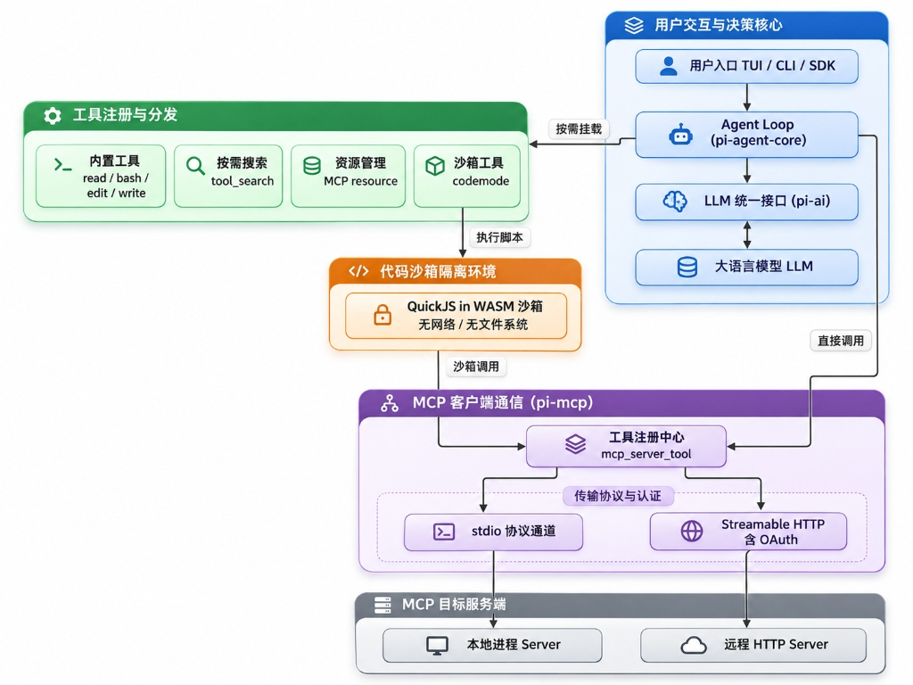
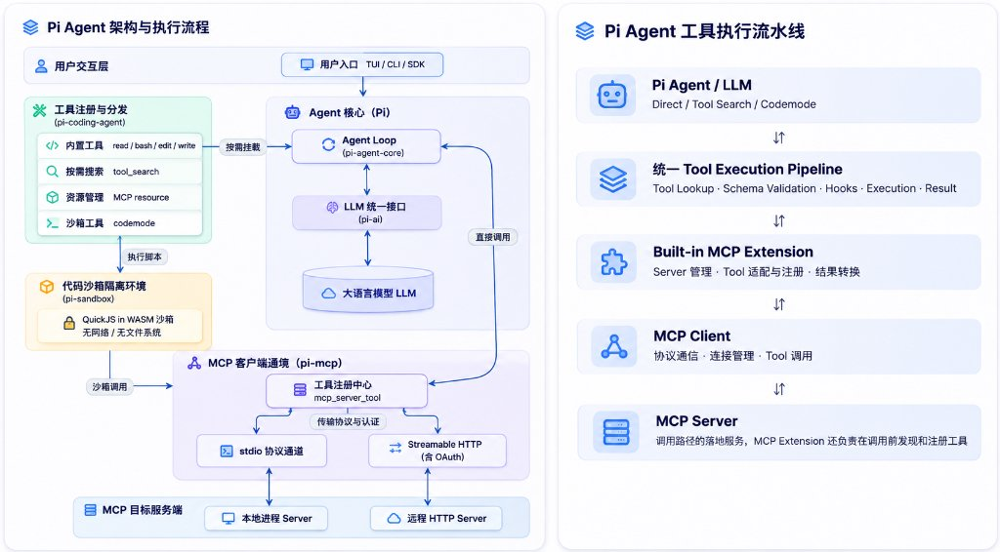

# Pi Agent 的 MCP 实现与架构

## 一、Pi Agent 是如何实现 MCP 的？

### 1. 架构概览

### 2. 最关键的设计：Pi把 mcp连接和工具怎么进模型上下文 拆开

协议层始终是 pi-mcp；模型侧按每个 Server 的 exposure 走 codemode / deferred / direct / hidden。默认是 codemode。

| Exposure | 行为 | 典型用途 |
| --- | --- | --- |
| `codemode`（默认） | 可从 codemode 脚本调用，但既不声明给模型，也不列在 codemode 描述里。脚本用 `searchTools()`、`describeTool()` 或 `ALL_TOOLS` 发现工具。 | 大多数 MCP 服务器，尤其需要组合调用或过滤大结果时 |
| `deferred` | 不预先声明，直到 `tool_search` 匹配到后，才在下一次模型调用中声明，之后可直接调用 | 工具很多、希望发现后再直接调用的服务器 |
| `direct` | 像内置工具一样直接声明给模型，同时也可从 codemode 调用 | 小型、经常使用的工具集 |
| `hidden` | 已注册但不可达 | 需要保持不可用的服务器或工具 |

因此它区分了三个状态：

> **服务已连接 → 工具已注册 → 工具是否出现在模型请求里。**

这三件事不是一回事。

默认的 codemode 路径还能在脚本中组合多个 MCP 调用、过滤返回数据，只把最终所需内容交给模型，从而减少 schema 和结果对上下文的占用。

