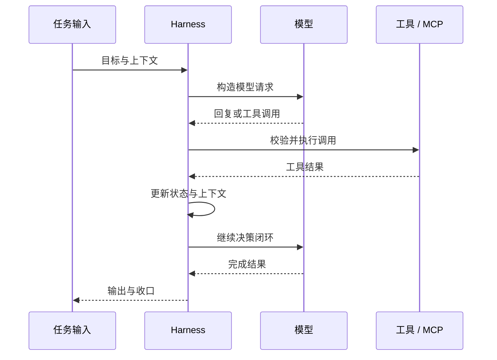

---
# Generated by scripts/catalog.mjs from knowledge-tree.json.
title: "Harness"
description: "Harness 为模型提供运行环境：组织上下文、执行工具、管理状态、控制生命周期与处理异常。"
docType: index
outline: [2, 3]
---

# Harness

Harness 为模型提供运行环境：组织上下文、执行工具、管理状态、控制生命周期与处理异常。

[← Agent Engineering](/ai/agent/)

## 推荐学习路径

1. 先理解 Agent 架构，再读 Harness 的模块构成。
2. 沿模型请求 → 工具执行 → 状态更新 → 下一轮请求追踪调用链。
3. 用 DeepSeek Harness 架构分析对照模块、边界与工程取舍。

## 知识关系与执行链路

## 知识模块

完整文章负责讲透机制；补充笔记保留不同视角；提纲与待补充条目按实际完成度标注。

- [Harness 的模块构成](/ai/agent/harness/harness-modules)

- [DeepSeek Harness 架构详解](/ai/agent/harness/deepseek-harness)

## 关联专题

- [Agent 架构](/ai/agent/architecture/)
- [MCP](/ai/agent/mcp/)
- [软件架构](/engineering/architecture/)

[到面试与题库练习表达](/interview/ai/)

## 维护约定

一个知识点维护一个主文档。学习导航和面试专题引用原文；同题的简记、详解、口述稿保留并标明用途。新内容先确定主归属，再补充专题与回链。
