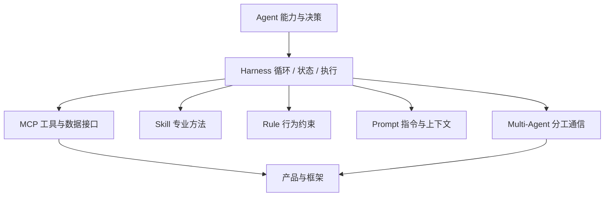

---
# Generated by scripts/catalog.mjs from knowledge-tree.json.
title: "Agent Engineering"
description: "Agent 是决策与行动系统；Harness 是模型之外的执行环境；MCP 是外部能力接口；Skill/Rule/Prompt 是专业能力、行为约束和上下文载体。它们不是互相替代的产品名。"
docType: index
outline: [2, 3]
---

# Agent Engineering

Agent 是决策与行动系统；Harness 是模型之外的执行环境；MCP 是外部能力接口；Skill/Rule/Prompt 是专业能力、行为约束和上下文载体。它们不是互相替代的产品名。

[← AI 与 Agent](/ai/)

## 推荐学习路径

1. Agent 架构明确能力模块和执行闭环。
2. Harness 把模型、工具、状态、权限与生命周期编排成可执行系统。
3. MCP 连接外部能力，扩展机制提供专业指令；在此基础上再组织多 Agent。

## 知识关系与执行链路

## 知识模块

完整文章负责讲透机制；补充笔记保留不同视角；提纲与待补充条目按实际完成度标注。

## Agent 架构 {#topic-4-1}

关注一个 Agent 内部的感知、上下文、决策、行动与反馈，以及一次任务如何闭环。

[进入Agent 架构学习导航](/ai/agent/architecture/)

## Multi-Agent {#topic-4-2}

多 Agent 的分工、通信、状态共享和调度。先理解单 Agent 执行环境，才容易判断拆分是否有收益。

[进入Multi-Agent学习导航](/ai/agent/multi-agent/)

## Harness {#topic-4-3}

Harness 为模型提供运行环境：组织上下文、执行工具、管理状态、控制生命周期与处理异常。

[进入Harness学习导航](/ai/agent/harness/)

## MCP {#topic-4-4}

MCP 规范 Host、Client 与 Server 的连接和能力调用。Pi 的实现分析用于说明协议能力如何接入 Agent 工具系统。

[进入MCP学习导航](/ai/agent/mcp/)

## Agent 扩展机制 {#topic-4-5}

Skill 组织专业任务方法，Rule 约束行为，Prompt 定义指令与上下文。通用提示词工程在独立专题维护，此处关注 Agent 侧扩展。

[进入Agent 扩展机制学习导航](/ai/agent/extensions/)

## Agent 产品与框架 {#topic-4-6}

产品与框架是架构概念的具体实现，而不是平行于 Agent、Harness 和 MCP 的理论分类。

[进入Agent 产品与框架学习导航](/ai/agent/ecosystem/)

## 关联专题

- [Prompt Engineering](/ai/prompt-engineering/)
- [RAG](/ai/rag/)
- [AI 面试](/interview/ai/)

[到面试与题库练习表达](/interview/ai/)

## 维护约定

一个知识点维护一个主文档。学习导航和面试专题引用原文；同题的简记、详解、口述稿保留并标明用途。新内容先确定主归属，再补充专题与回链。
