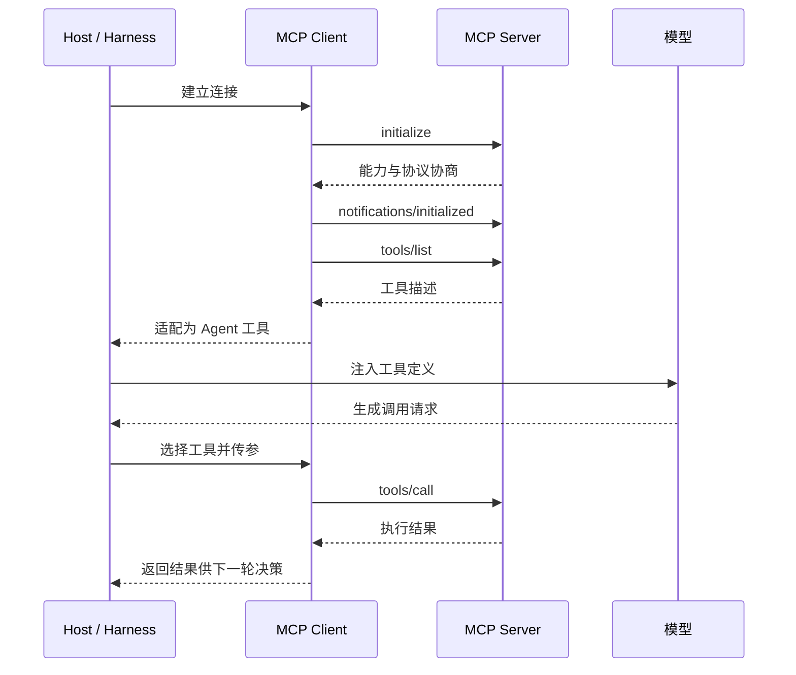

---
# Generated by scripts/catalog.mjs from knowledge-tree.json.
title: "MCP"
description: "MCP 规范 Host、Client 与 Server 的连接和能力调用。Pi 的实现分析用于说明协议能力如何接入 Agent 工具系统。"
docType: index
outline: [2, 3]
---

# MCP

MCP 规范 Host、Client 与 Server 的连接和能力调用。Pi 的实现分析用于说明协议能力如何接入 Agent 工具系统。

[← Agent Engineering](/ai/agent/)

## 推荐学习路径

1. 先读 MCP 系统性知识，理解角色、握手和传输。
2. 再追踪工具发现、工具描述注入与 tools/call 调用。
3. 最后用 Pi Agent 和平台自研方案对照协议层、适配层与模型上下文。

## 知识关系与执行链路

## 知识模块

完整文章负责讲透机制；补充笔记保留不同视角；提纲与待补充条目按实际完成度标注。

- [MCP 系统性知识](/ai/agent/mcp/mcp-fundamentals)

## MCP 生命周期 {#topic-4-4-2}

握手与连接生命周期见 MCP 系统性知识。

- [MCP 系统性知识](/ai/agent/mcp/mcp-fundamentals)

## MCP Client 与 Server {#topic-4-4-3}

Host、Client、Server 的职责见核心架构部分。

- [MCP 系统性知识](/ai/agent/mcp/mcp-fundamentals)

## MCP Tool 调用机制 {#topic-4-4-4}

- [MCP 系统性知识](/ai/agent/mcp/mcp-fundamentals)
- [Pi Agent MCP](/ai/agent/mcp/pi-agent-mcp)

- [Pi Agent MCP](/ai/agent/mcp/pi-agent-mcp)

- [MCP 平台自研方案](/ai/agent/mcp/platform-design)

- [mcpServer工具如何变成agentTool（待补充）](/ai/agent/mcp/server-tools-to-agent-tools)

## 关联专题

- [Harness](/ai/agent/harness/)
- [Agent 扩展机制](/ai/agent/extensions/)
- [网络](/frontend/network/)

[到面试与题库练习表达](/interview/ai/)

## 维护约定

一个知识点维护一个主文档。学习导航和面试专题引用原文；同题的简记、详解、口述稿保留并标明用途。新内容先确定主归属，再补充专题与回链。
