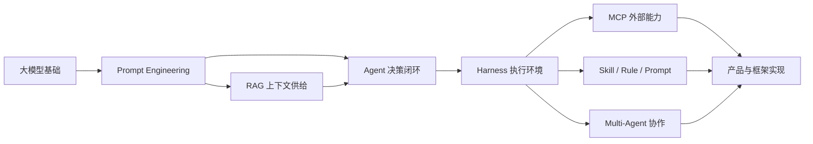

---
# Generated by scripts/catalog.mjs from knowledge-tree.json.
title: "AI 与 Agent"
description: "从模型与上下文出发，理解检索增强、Agent 决策、运行环境和工具扩展。产品分析回到架构概念，不以产品名切碎知识体系。"
docType: index
outline: [2, 3]
---

# AI 与 Agent

从模型与上下文出发，理解检索增强、Agent 决策、运行环境和工具扩展。产品分析回到架构概念，不以产品名切碎知识体系。

## 推荐学习路径

1. 模型训练 → Prompt Engineering → RAG：先理解模型能力与上下文来源。
2. Agent 架构 → Harness → MCP → 扩展机制：贯通决策、执行与工具连接。
3. 最后研究多 Agent 协作和 OpenClaw 等实现，把抽象结构映射回真实产品。

## 知识关系与执行链路

## 知识模块

完整文章负责讲透机制；补充笔记保留不同视角；提纲与待补充条目按实际完成度标注。

## 大模型基础 {#topic-1}

模型训练与能力来源，为提示词、检索增强和 Agent 工程提供背景。

[进入大模型基础学习导航](/ai/llm/)

## Prompt Engineering {#topic-2}

围绕目标、上下文、约束和输出协议设计模型输入；Agent 专用扩展通过关联链接查阅。

[进入Prompt Engineering学习导航](/ai/prompt-engineering/)

## RAG {#topic-3}

检索增强生成：将外部资料转化为可检索上下文，补足模型在知识与证据上的边界。

[进入RAG学习导航](/ai/rag/)

## Agent Engineering {#topic-4}

Agent 是决策与行动系统；Harness 是模型之外的执行环境；MCP 是外部能力接口；Skill/Rule/Prompt 是专业能力、行为约束和上下文载体。它们不是互相替代的产品名。

[进入Agent Engineering学习导航](/ai/agent/)

## 关联专题

- [Agent Engineering](/ai/agent/)
- [软件架构](/engineering/architecture/)
- [AI 面试](/interview/ai/)

[到面试与题库练习表达](/interview/ai/)

## 维护约定

一个知识点维护一个主文档。学习导航和面试专题引用原文；同题的简记、详解、口述稿保留并标明用途。新内容先确定主归属，再补充专题与回链。
