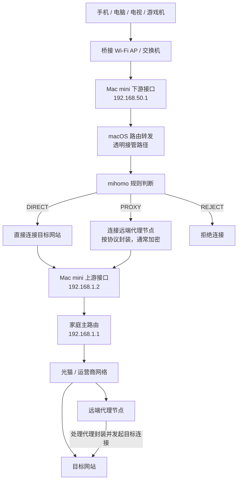

# Mac mini + mihomo 家庭局域网代理网关

## 一、这套方案解决什么问题

让手机、电脑、电视、游戏机共用一套网络分流策略，而不是在每台设备上分别安装和配置代理客户端。

核心思路是：**把 Mac mini 放在家庭终端与主路由之间，让它既做默认网关，又运行 mihomo 作为代理分流中心。**

- 终端只需要连接家庭 Wi-Fi 或交换机，取得正确的 IP、默认网关与 DNS。
- Mac mini 负责接收需要跨网段转发的数据包，并将需要分流的流量交给 mihomo。
- mihomo 按规则决定直连、使用代理节点或拒绝连接。
- 家里的主路由继续负责上游互联网出口，不必替换原有光猫和宽带接入方式。

这里的“透明”是指终端应用不需要配置 HTTP/SOCKS 代理；它不代表流量会自动被接管，也不代表所有协议都能通过任意代理节点。

> 本文是架构与实施说明，采用双接口、双网段的 IPv4 方案。地址与接口名用于举例；macOS 转发流量能否进入 TUN，需要结合实际 mihomo 版本、系统路由和防火墙验证。本文不把“本机 TUN 能用”等同于“全家设备已接管”。

## 二、整体网络拓扑

### 2.1 物理连接与网段划分


图中的网络分为两个 IPv4 子网：

```text
互联网
  │
光猫
  │
家庭主路由：192.168.1.1
  │
  │ 上游网络：192.168.1.0/24
  │
Mac mini 上游接口：192.168.1.2
┌───────────────────────────────────────────┐
│ Mac mini                                  │
│                                           │
│ macOS：IP Forwarding / 路由 / 必要的 NAT   │
│ mihomo：透明接管 / DNS / 规则分流          │
└───────────────────────────────────────────┘
Mac mini 下游接口：192.168.50.1
  │
  │ 下游网络：192.168.50.0/24
  │
交换机 / Wi-Fi AP：桥接模式
  ├── 手机：192.168.50.100
  ├── 电脑：192.168.50.101
  └── 电视 / 游戏机：192.168.50.102 等

终端默认网关：192.168.50.1
终端 DNS：192.168.50.1（需要在 Mac mini 上运行 DNS 服务）
```

上下游应是不同的二层网络，或通过 VLAN 做等效隔离。**仅仅给同一台交换机上的设备分配两组 IP，并不能替代这里的网络隔离。**

如果 AP 的上联又直接接回主路由所在的上游网络，终端就可能获得主路由的 DHCP 配置，绕过 Mac mini。

### 2.2 请求进入 Mac mini 后怎么分流

下面画的是请求方向；响应沿对应连接或 NAT 状态返回。



**主路由是物理下一跳；远端代理节点是代理流量在互联网中的逻辑下一站。** 二者不是互相替代的出口。

## 三、最重要的设备：Mac mini

Mac mini 不再只是普通电脑，而是同时承担两个角色。

### 3.1 Router：路由器

负责把下游设备需要访问其他网络的数据包转发出去。

例如手机访问公网网站：

1. 手机判断目标地址不在自己的 `192.168.50.0/24` 子网。
2. 手机通过 ARP 找到默认网关 `192.168.50.1` 的 MAC 地址。
3. 以太网帧发送给 Mac mini，IP 数据包的目的地址仍然是目标地址，而不是改成 Mac mini。
4. Mac mini 根据路由表、转发开关和防火墙决定下一步如何处理。

**默认网关负责“下一跳交给谁”；并不会自动把普通 TCP/UDP 变成 HTTP 或 SOCKS 代理请求。**

### 3.2 Proxy Gateway：代理网关

通过透明接管机制，把需要分流的连接交给 mihomo。

mihomo 负责：

- 根据域名、目标 IP、来源 IP、端口等信息匹配规则。
- 对直连流量建立直接出站连接。
- 对代理流量连接选中的代理节点，并按代理协议封装数据。
- 按配置处理 DNS、fake-IP 映射及拒绝规则。

TUN 的作用是提供一个虚拟三层接口，让进入该接口的 IP 流量交由用户态网络栈处理。**创建 TUN 接口只是入口，仍要让下游转发流量确实被路由到这个入口。**

### 3.3 三层职责划分

| 层次 | 设备 | 职责 |
| --- | --- | --- |
| 终端层 | 手机、电脑、电视、游戏机 | 发起网络请求，使用 DHCP 或静态网络配置 |
| 网关层 | Mac mini + mihomo | 路由转发、透明接管、DNS、规则分流及必要的 NAT |
| 接入层 | 交换机 / Wi-Fi AP | 提供有线与无线二层接入，不承担本方案的路由和 NAT |
| 出口层 | 主路由、光猫、运营商 | 提供上游互联网连接；主路由通常承担家庭公网出口 NAT |

## 四、接口与地址规划

### 4.1 推荐配置

| 设备 / 接口 | IPv4 地址 | 子网掩码 | 默认网关 | 说明 |
| --- | --- | --- | --- | --- |
| 主路由 LAN | `192.168.1.1` | `255.255.255.0` | 由宽带接入决定 | 上游家庭网络 |
| Mac mini 上游接口 | `192.168.1.2` | `255.255.255.0` | `192.168.1.1` | 使用固定地址或 DHCP 静态租约 |
| Mac mini 下游接口 | `192.168.50.1` | `255.255.255.0` | 不设置第二个普通默认网关 | 作为终端的默认网关 |
| AP 管理地址 | `192.168.50.2` | `255.255.255.0` | `192.168.50.1` | 管理地址与 DHCP 地址池错开 |
| 下游 DHCP 地址池 | `192.168.50.100–199` | `255.255.255.0` | `192.168.50.1` | DNS 按本方案发布为 `192.168.50.1` |

图中的 WAN/LAN 是**接口角色**。Mac mini 上游的 `192.168.1.2` 仍然是私网地址，不是公网 WAN 地址。

Mac mini 的普通上游默认网关保持指向主路由。TUN 启用后可能增加更具体的路由，不能因此把上游网络服务的“路由器”地址改成 Mac mini 自己。

### 4.2 Mac mini 需要两个逻辑接口

常见组合是：

- 内置以太网连接主路由，USB/雷雳以太网适配器连接下游交换机。
- 两个有线接口分别承载上游与下游，独立 AP 提供 Wi-Fi。
- 使用支持 VLAN 的设备，通过一个物理接口承载两个隔离的逻辑网络。

具体名字可能是 `en0`、`en5` 等，不能假定所有 Mac 都相同。可使用以下命令确认：

```bash
networksetup -listallhardwareports
ifconfig
```

双有线接口通常比“Wi-Fi 上游 + 有线下游”更容易获得稳定链路，也更便于排查。

### 4.3 AP 和 DHCP 分开看

AP 使用桥接模式意味着它主要转发二层帧，不在上下游之间再次路由或 NAT。

下游仍需要**一个明确的 DHCP 服务**，可以部署在 Mac mini，或由下游其他支持自定义网关、DNS 的设备提供。桥接 AP 不一定具备可用的 DHCP 服务，不要默认它会自动完成地址分配。

DHCP 应发布：

```text
地址池：192.168.50.100–192.168.50.199
子网掩码：255.255.255.0
Router / Option 3：192.168.50.1
DNS / Option 6：192.168.50.1
```

同一个下游广播域中只保留一套预期的 DHCP 配置，避免设备随机获得不同网关。

## 五、路由转发、NAT 与透明接管不是同一件事

| 机制 | 解决的问题 | 不会自动解决什么 |
| --- | --- | --- |
| IP Forwarding | 允许 macOS 转发不属于本机的 IP 数据包 | 不自动分配地址，不自动代理，也不自动提供回程路由 |
| 路由表 | 决定目标网络对应的出接口和下一跳 | 不会因为安装了 mihomo 就必然接管下游连接 |
| NAT | 改写地址/端口并维护回程状态，常用于共享上游出口 | 不进行域名规则分流，不提供代理协议封装 |
| TUN / 透明接管 | 把符合条件的 IP 流量送入 mihomo | 不等于所有接口、所有协议、IPv4/IPv6 都已覆盖 |
| mihomo 规则 | 决定 DIRECT、代理节点或 REJECT | 不替代物理接线、DHCP、系统转发与防火墙配置 |

### 5.1 普通路由流量为什么可能需要 NAT

如果下游原始数据包直接由 macOS 转发给主路由，其来源仍是 `192.168.50.100`。主路由通常只直接连接 `192.168.1.0/24`，不一定知道如何返回下游网络。

有两种处理方式。

**方式 A：Mac mini 做源 NAT。**

```text
手机来源地址：192.168.50.100
  ↓ Mac mini 源 NAT
上游可见来源：192.168.1.2
  ↓ 主路由出口 NAT
公网可见来源：家庭宽带出口地址
```

这种普通转发路径通常形成两层 NAT，容易兼容现有主路由，但会增加入站连接和游戏联机的配置复杂度。

**方式 B：主路由配置下游静态路由，Mac mini 不做这层源 NAT。**

```text
目标网段：192.168.50.0/24
下一跳：192.168.1.2
```

这要求主路由同时允许该子网转发到互联网，并在公网出口对它进行必要的 NAT；**只添加静态路由并不保证能上网**。

静态路由是回程设计，不是 mihomo 流量接管配置。

### 5.2 被 mihomo 接管的连接不一定再经过相同的 NAT 链

TUN 用户态代理会处理原始流量，并通过 DIRECT 或代理出站建立新的连接。新的上游连接通常以 Mac mini 的上游地址为源地址。

因此，不应把所有连接机械地理解成：

```text
原始终端数据包 → Mac mini NAT → mihomo → 主路由 NAT
```

更准确的区分是：

- **普通内核转发路径**：原始终端流量经过路由转发，按设计使用源 NAT 或静态回程路由。
- **mihomo 接管路径**：流量进入 TUN，由用户态处理并建立出站连接，响应再由 mihomo 返回终端。

NAT、TUN 和防火墙规则的处理位置会影响来源地址识别与实际流量路径。不要让源 NAT 提前抹掉需要用于终端分流的来源 IP，也不要让接管后的出站连接再次进入 TUN，形成回环。

## 六、直连与代理流量的完整链路

### 6.1 DIRECT：直连流量

以一个命中直连规则的 HTTPS 网站为例：

```text
手机
  → AP / 交换机
  → Mac mini
  → mihomo 判断为 DIRECT
  → Mac mini 从上游接口直接连接目标网站
  → 主路由
  → 光猫 / 运营商
  → 目标网站
```

“直连”指**不经过远端代理节点**，不是绕过 Mac mini，也不是绕过主路由。

同一子网的设备互访则通常不经过默认网关。例如手机访问同网段电脑的真实 IP，会通过二层网络直接通信。这类流量不要与“经过 mihomo 后选择 DIRECT 的公网连接”混为一谈。

### 6.2 PROXY：代理流量

```text
手机
  → AP / 交换机
  → Mac mini
  → mihomo 判断为 PROXY
  → 连接远端代理节点并按协议封装
  → 主路由
  → 光猫 / 运营商
  → 远端代理节点
  → 节点处理代理封装并连接目标网站
```

这时有两段逻辑连接：

1. **Mac mini → 远端代理节点**：传输代理协议封装后的数据，常见方案还提供外层加密。
2. **远端代理节点 → 目标网站**：由节点建立目标连接，目标网站通常看到节点出口 IP。

如果应用访问 HTTPS，网站 TLS 加密通常仍保持在终端与目标网站之间。代理节点处理外层代理封装，**不等于解密了网站 HTTPS 正文**。

### 6.3 响应如何回来

- 代理流量：目标网站 → 代理节点 → Mac mini 的 mihomo → 终端。
- mihomo DIRECT 流量：目标网站 → Mac mini 的 DIRECT 出站连接 → mihomo → 终端。
- 普通路由流量：依赖 NAT 状态或静态路由返回 Mac mini，再转发到下游。

排查网络问题时要同时看请求和响应。只有“能发出去”，却没有正确回程，仍然会表现为连接超时。

## 七、DNS：让域名规则真正发挥作用

### 7.1 终端默认网关和 DNS 是两个独立配置

把网关设为 `192.168.50.1`，不代表 DNS 就一定交给 mihomo。

例如：

```text
默认网关：192.168.50.1
DNS：192.168.1.1
```

这台终端仍可能通过 Mac mini 转发，把 DNS 请求直接交给主路由。如果 mihomo 没有看到查询，也没有其他可靠的域名信息来源，域名分流就可能退化为 IP 分流。

推荐让下游设备使用 Mac mini 上实际可访问的 DNS 服务：

```text
终端 → 192.168.50.1:53 → mihomo DNS 或本地 DNS 转发器 → 上游 DNS
```

这个服务必须监听下游地址，并允许 TCP/UDP 53。如果 mihomo 只监听 `127.0.0.1:1053`，终端不能直接访问；需要本地转发器把 `192.168.50.1:53` 转发过去。

### 7.2 redir-host 与 fake-IP

| 模式 | 终端得到的地址 | 特点 |
| --- | --- | --- |
| `redir-host` | 真实解析地址 | 便于先验证基础链路；域名识别仍依赖 DNS 记录、嗅探等机制 |
| `fake-ip` | 例如 `198.18.0.0/16` 中的占位地址 | 利用假 IP 与域名映射进行规则判断，要求假 IP 流量始终被正确接管 |

fake-IP 不是可直接发送给公网的目标地址。如果终端拿到了 fake-IP，而后续流量没有进入 mihomo，会出现“DNS 能解析，但网站打不开”。

采用 fake-IP 时应确保：

- 假 IP 地址池不与家庭网段、其他 VPN 或实验网络冲突。
- 对假 IP 地址的连接确实进入 TUN。
- DNS 返回映射与接管流量由相匹配的 mihomo 实例处理。
- 本地域名、设备发现与有兼容性要求的服务使用合适的过滤策略。

### 7.3 不要把 DNS 劫持当作万能覆盖

mihomo 的 TUN 文档明确说明，macOS/Windows 不能自动劫持发往局域网的 DNS 请求。因此，**直接通过 DHCP 发布正确的 DNS，比假定所有查询都能被拦截更可靠**。

普通 53 端口劫持也不能自动解开应用自带的 DoH/DoT。加密 DNS、缓存、直接访问 IP 都可能影响按域名分流的结果。

此外，节点域名解析要有可用的启动路径，避免“解析节点需要代理，连接代理又需要先解析节点”的循环依赖。

## 八、macOS + mihomo 的实施顺序

### 8.1 先打通普通网络，再启用透明代理

建议按以下顺序实施，每一步单独验收：

1. **确认接线与接口**：上游连主路由，下游连桥接 AP/交换机，两个广播域分开。
2. **固定地址**：上游 `192.168.1.2/24`，下游 `192.168.50.1/24`。
3. **配置下游 DHCP/DNS**：先用一台测试终端确认地址、网关、DNS 正确。
4. **启用转发与回程机制**：在不启用 TUN 时验证下游可以普通直连上网。
5. **验证 mihomo 自身**：确认 Mac mini 能连接节点，显式代理测试通过。
6. **启用透明接管**：让下游跨网段流量进入 TUN，排除本地网络及必要的上游连接。
7. **验证规则分流**：分别测试 DIRECT、PROXY、DNS 和 UDP。
8. **配置长期运行**：处理服务自启动、权限、转发设置恢复、睡眠和故障恢复。

不要一开始同时修改网段、DHCP、DNS、NAT、TUN 和订阅规则，否则失败后很难判断是哪一层出了问题。

### 8.2 macOS 路由与转发

查看 IPv4 转发开关：

```bash
sysctl net.inet.ip.forwarding
```

临时开启 IPv4 转发的命令是：

```bash
sudo sysctl -w net.inet.ip.forwarding=1
```

这只开启转发，不会自动配置 NAT、DHCP、DNS 或 mihomo；重启后的恢复也需要单独设计。

macOS 的 NAT/防火墙可以通过 PF 及相应系统服务管理。采用自定义 PF 方案时，应使用独立 anchor 并确认加载顺序，不要整份覆盖系统规则，尤其要避免与互联网共享或其他网络软件同时管理相同路径。

macOS 自带“互联网共享”可以作为普通共享上网的实现途径，但系统会管理下游接口、地址分配和相关规则。使用它时应以实际生成的配置为准，不能假定下游仍是 `192.168.50.0/24`，也不能假定共享出去的流量已进入 mihomo。

### 8.3 mihomo 配置关注点

以下是**用于说明字段职责的配置片段**，不是包含节点与完整规则的一键部署文件。示例假定上游接口为 `en0`，并且主路由能提供 DNS：

```yaml
mode: rule
find-process-mode: off
interface-name: en0

external-controller: 127.0.0.1:9090

# 先使用真实解析地址验证链路，再按需求引入 fake-IP。
dns:
  enable: true
  listen: 192.168.50.1:53
  ipv6: false
  enhanced-mode: redir-host
  nameserver:
    - 192.168.1.1
  proxy-server-nameserver:
    - 192.168.1.1

# auto-route 是自动路由配置，不是下游接管成功的证明。
tun:
  enable: true
  stack: gvisor
  auto-route: true
  dns-hijack:
    - any:53
    - tcp://any:53
  route-exclude-address:
    - 192.168.1.0/24
    - 192.168.50.0/24
```

需要结合实际环境调整：

- `interface-name` 指向真实上游接口，保证出站连接不会再次回到 TUN；同时核对代理节点连接的实际路径。
- 下游网段的直连路由要保留，确保响应能回到终端；上游路由器和管理地址也应可达。
- `dns.listen` 使用 53 端口需要相应权限，并确认没有与现有 DNS 服务冲突。
- 本例使用局域网主路由做上游 DNS，必须确认它确实提供 DNS 服务；生产环境应按解析质量与分流需求另行设计。
- `find-process-mode: off` 适合网关场景：Mac mini 不能把转发连接可靠归属为终端设备中的某个应用进程。
- `gvisor` 是本例选用的协议栈，不代表所有版本的默认值或性能最优值。
- macOS TUN 设备名使用 `utun` 前缀。Linux 的 `auto-redirect`、iptables/nftables 或 `routing-mark` 方案不能直接搬到 macOS。

`allow-lan: true` 允许其他设备使用 mihomo 的代理监听端口，**并不是“开启局域网透明代理”的开关**。上述 DNS 监听也需要独立核对，不要用 `allow-lan` 代替监听地址和防火墙配置。

规则顺序建议先处理本地地址，再处理业务域名/IP，最后设置默认策略。具体代理策略组应引用现有配置中的真实名称，不能只添加一个没有对应节点的 `PROXY` 字符串。

### 8.4 最关键的验证：下游流量确实进入 mihomo

至少同时满足：

- 终端使用 Mac mini 作为网关，并且没有设置显式应用代理。
- 从终端发起新连接，mihomo 日志或连接面板能看到对应连接。
- 能辨别终端来源 IP，并观察命中的规则与 DIRECT/代理出站。
- 代理连接的公网出口符合所选节点，直连连接符合家庭出口。
- 修改一条测试规则后，终端的新连接出现预期变化。

**如果只有 Mac mini 自己的请求出现在连接面板，而手机/电视的请求没有出现，说明本机代理有效，但下游透明接管尚未成立。**

出口 IP 只是辅助证据。某个网站被设为 DIRECT、已有连接复用或 IPv6 绕行，都可能让单次出口测试产生误判。

## 九、验证与排障清单

### 9.1 基础检查

| 检查项 | 预期结果 | 不符合时优先检查 |
| --- | --- | --- |
| 终端 IPv4 地址 | `192.168.50.x/24` | 接线、AP 模式、DHCP 来源 |
| 终端默认网关 | `192.168.50.1` | DHCP Option 3、静态配置 |
| 终端 DNS | 指向实际运行的下游 DNS 服务 | DHCP Option 6、应用加密 DNS |
| 终端访问 Mac mini 下游地址 | 连通或能访问预期服务 | 网卡状态、二层网络、防火墙 |
| Mac mini 访问主路由 | `192.168.1.1` 可达 | 上游地址、网线、接口 |
| 不启用 TUN 的普通上网 | 测试终端能联网 | 转发、NAT/静态回程、主路由出口 |
| mihomo 连接面板 | 出现终端新连接与规则结果 | TUN 路由、接管路径、来源地址 |
| UDP 业务 | DNS、游戏等按预期运行 | 节点 UDP 支持、防火墙、超时、MTU |

Mac mini 上的只读检查命令：

```bash
# 查看路由及到主路由的路径
netstat -rn -f inet
route -n get 192.168.1.1

# 查看是否启用 IPv4 转发
sysctl net.inet.ip.forwarding

# 查看 DNS 53 端口监听
sudo lsof -nP -iUDP:53 -iTCP:53

# 查看 PF 状态与 NAT 规则；自定义 anchor 还需按实际名称进一步查看
sudo pfctl -s info
sudo pfctl -s nat
```

在支持相应命令的**下游测试电脑**上执行：

```bash
# 检查指定 DNS 是否能应答
nslookup example.com 192.168.50.1

# 显示到公网目标的路径；ICMP 被过滤时不一定显示完整跳数
traceroute -n 1.1.1.1
```

### 9.2 常见现象与原因

| 现象 | 常见原因 |
| --- | --- |
| Mac mini 能上网，手机不能 | 只验证了本机网络；下游转发、地址分配或回程未配置 |
| 所有终端都能上网，但看不到 mihomo 连接 | 流量走普通路由/NAT，未进入 TUN |
| 改了网关，代理仍未生效 | 默认网关只改变下一跳，透明接管机制仍缺失 |
| DNS 成功但网站无法连接 | fake-IP 未接管、DNS 映射不匹配、节点/回程失败 |
| 浏览器正常，游戏或语音失败 | TCP 可用但 UDP、端口或节点能力不匹配 |
| 局域网打印、投屏、设备发现异常 | 设备跨子网、组播未转发、AP 隔离或本地解析策略问题 |
| 运行一段时间后全家断网 | Mac 睡眠、网卡断连、进程退出、规则被其他服务改写 |
| 部分请求仍从家庭公网出口出去 | DIRECT 规则、未接管流量或 IPv6 绕行，需分别确认 |

## 十、边界、取舍与故障处理

### 10.1 IPv6 需要单独设计

IPv4 网关设置不会改变终端通过 IPv6 Router Advertisement 获得的默认路由。

如果主路由的 IPv6 通告通过其他路径到达终端，终端可能直接使用主路由作为 IPv6 网关，绕过 Mac mini。

初次部署可先限定为 IPv4，避免在下游发布未受控的 IPv6 默认路由。后续需要 IPv6 时，再完整配置地址前缀、路由通告、转发、防火墙、DNS 和 mihomo 接管。

**`dns.ipv6: false` 只是 DNS 应答策略，不等于在网络层关闭 IPv6，更不能拦住应用访问已有 IPv6 地址。**

### 10.2 游戏机与入站连接

双层 NAT、代理节点和不完整的 UDP 支持都会影响 NAT 类型与联机体验。UPnP 通常不会自动跨越两层 NAT；透明代理也不会让远端节点自动开放入站端口。

可优先考虑对特定游戏机来源 IP 或游戏服务直连，再结合主路由静态路由、必要的端口映射等方案评估。直连并不会自动解决双层 NAT，因此应根据实际联机测试取舍。

### 10.3 Mac mini 是单点故障

所有接入下游网络的设备都依赖 Mac mini。它睡眠、关机或网卡故障时，终端无法正常跨网段上网。

长期运行应处理：

- 接通电源时避免自动系统睡眠，允许显示器独立休眠。
- mihomo、DHCP/DNS 等服务在合适权限下自启动。
- 重启后恢复接口配置、转发设置与必要的 PF 规则。
- 记录已验证的配置，更新内核或系统后做回归测试。

“mihomo 停止后自动直连”不是天然特性。残留 TUN 路由、fake-IP 缓存或防火墙规则都可能让连接继续失败；要实现故障直连，需要明确的检测、路由恢复和 DNS 切换方案。

### 10.4 预留恢复网络

最简单的恢复方式，是保留主路由原有 Wi-Fi 或一个上游有线接口。Mac mini 故障时，让需要联网的设备改连主路由，重新获取 `192.168.1.x` 地址、`192.168.1.1` 网关及可用 DNS。

不能在 `192.168.50.0/24` 的终端上只把默认网关改成 `192.168.1.1`：主路由不在该终端的本地子网，普通情况下无法直接作为下一跳。

### 10.5 管理面与接入面分开

mihomo 控制 API 默认优先只绑定回环地址；需要远程管理时另行设置认证和访问范围。DHCP、DNS 与可选代理监听端口按用途开放到下游，不必把所有管理服务都暴露给上下游网络。

本文描述的是“双接口串联式网关”，不是与主路由、终端全部处于同一子网的单臂旁路由。后者会涉及同接口进出、ICMP 重定向、回程不对称等额外问题，不应直接套用本文的地址规划。

## 十一、总结

这套方案可以概括为：

> **终端把 Mac mini 当作默认网关，macOS 提供路由转发及必要的回程机制，mihomo 负责透明接管和规则分流，主路由继续提供互联网出口。**

部署是否成立，取决于五件事是否同时正确：

1. **接线与地址**：上下游分开，终端处于正确的下游网段。
2. **默认网关与 DNS**：终端把请求送到预期的网关与解析服务。
3. **转发与回程**：请求能出去，响应能返回终端。
4. **透明接管与出站**：下游流量进入 mihomo，出站连接不发生回环。
5. **分流与持续运行**：DIRECT/PROXY、UDP、IPv6 边界和故障恢复都经过验证。

Mac mini 是整套家庭网络的默认网关与策略中心；“它能上网”只是起点，**“终端流量按预期路径经过它”才是验收标准**。

## 相关知识

- [计算机网络五层模型](/computer-science/networking/five-layer-model)
- [正向代理与反向代理](/computer-science/networking/forward-reverse-proxy)
- [DNS 解析](/computer-science/networking/dns)
- [System Proxy / TUN / fake-IP](/tools/developer-tools/proxy-tun-fake-ip)
- [TCP 可靠性与 UDP](/computer-science/networking/tcp-reliability-udp)

## 参考资料

- [mihomo：TUN 配置](https://wiki.metacubex.one/config/inbound/tun/)：自动路由、macOS DNS 劫持限制、接口与平台差异。
- [mihomo：DNS 配置](https://wiki.metacubex.one/config/dns/)：监听地址、redir-host/fake-IP 和节点域名解析。
- [mihomo：全局配置](https://wiki.metacubex.one/config/general/)：局域网代理端口、出站接口、进程匹配与控制 API。
- [mihomo：入站配置](https://wiki.metacubex.one/config/inbound/)：代理端口、TUN 与 listeners 的职责。
- [Apple：与其他网络用户共享 Mac 上的互联网连接](https://support.apple.com/zh-cn/guide/mac-help/mchlp1540/mac)：macOS 互联网共享的官方配置入口。
