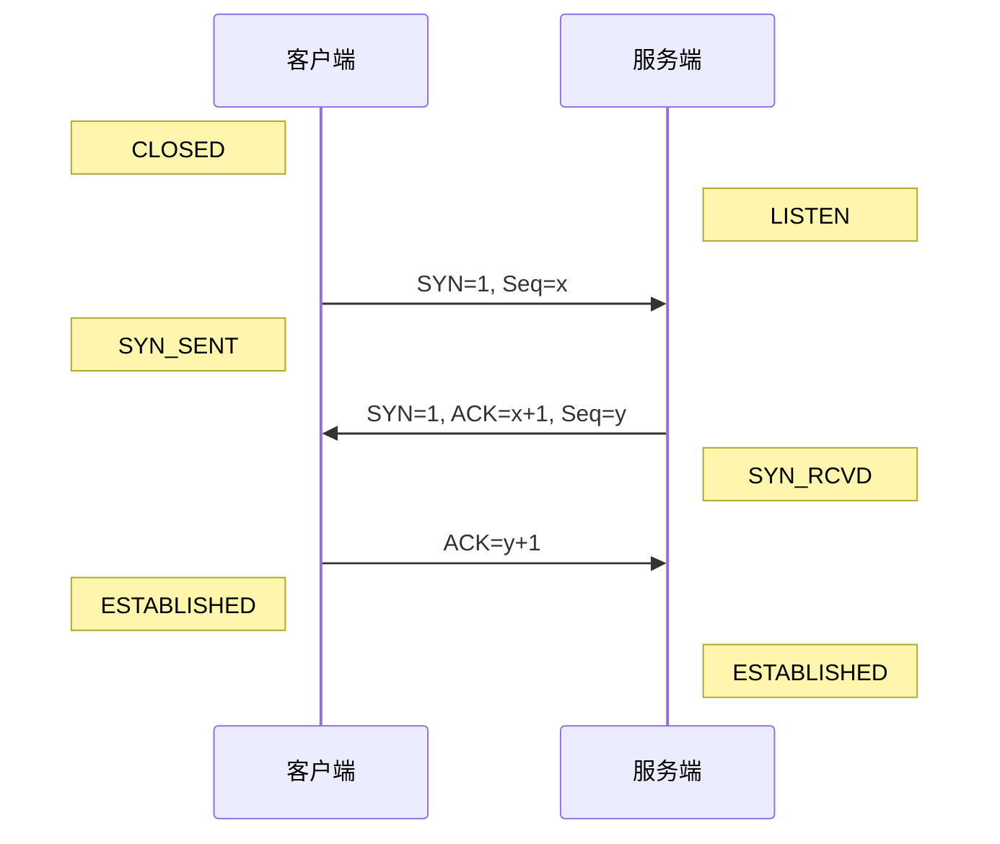
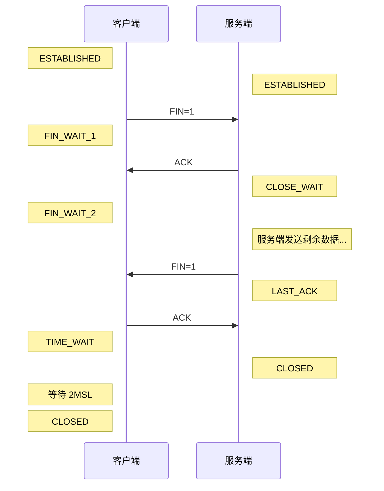

# TCP

TCP 是传输层协议，它为应用层提供了一种可靠的、面向连接的、字节流的传输服务。
## 连接管理

### 三次握手 (建立连接)

目的是确认双方的发送能力和接收能力都正常，并同步初始序列号 (ISN)。

#### 流程：

1. SYN：客户端发送 SYN=1, Seq=x。客户端进入 `SYN_SENT` 状态。（客户端：我想连接）。

2. SYN + ACK：服务端收到后，发送 SYN=1, ACK=x+1, Seq=y。服务端进入 `SYN_RCVD` 状态。（服务端：收到了，我也想连接）。

3. ACK：客户端收到后，发送 ACK=y+1。客户端进入 `ESTABLISHED` 状态，服务端收到后也进入 `ESTABLISHED` 状态。（客户端：好的，连接建立）。

#### 为什么是三次？

1. 防止历史连接初始化：如果是两次，一个失效的旧连接请求突然到达服务端，服务端直接建立连接，会浪费资源。三次握手允许客户端在收到服务端响应后检查序列号，如果是旧连接则发送 RST 拒绝。

2. 确认双向能力：
   1. 第一次：服务端确认（客户端发正常，服务端收正常）。
   2. 第二次：客户端确认（服务端发、收正常；客户端发、收正常）。
   3. 第三次：服务端确认（客户端收、发正常）。

### 四次挥手 (断开连接)

由于 TCP 是全双工的，发送方和接收方都需要单独关闭自己的发送通道。

#### 流程：

1. **第一次挥手 (FIN)**:
   - **客户端**: 发送 FIN=1，Seq=u。进入 `FIN_WAIT_1` 状态。
   - **含义**: 客户端说：“我没有数据要发了，请求断开”。

2. **第二次挥手 (ACK)**:
   - **服务端**: 收到 FIN，发送 ACK=1，Seq=v，ack=u+1。进入 `CLOSE_WAIT` 状态。
   - **客户端**: 收到 ACK 后，进入 `FIN_WAIT_2` 状态。
   - **含义**: 服务端说：“好的，我知道了，但我可能还有数据没传完，你先等等”。
   - **注意**: 此时连接处于 **半关闭 (Half-Close)** 状态。客户端无法发送数据，但仍可接收服务端的数据。

3. **第三次挥手 (FIN)**:
   - **服务端**: 数据发送完毕后，发送 FIN=1，ACK=1，Seq=w，ack=u+1。进入 `LAST_ACK` 状态。
   - **含义**: 服务端说：“我的数据也发完了，可以断开了”。

4. **第四次挥手 (ACK)**:
   - **客户端**: 收到 FIN，发送 ACK=1，Seq=u+1，ack=w+1。进入 `TIME_WAIT` 状态。
   - **服务端**: 收到 ACK 后，进入 `CLOSED` 状态，连接结束。
   - **客户端**: 等待 **2MSL** 后，自动进入 `CLOSED` 状态。
   - **含义**: 客户端说：“收到，拜拜”。

#### 为什么是四次？

1. 因为服务端收到 FIN 时，可能还有数据未处理完，不能立刻关闭连接，所以先回一个 ACK 表示“收到”，等处理完了再发 FIN 表示“可以关闭”。

#### 为什么有 TIME_WAIT (2MSL)？

1. 确保最后一个 ACK 能到达服务端：如果最后一个 ACK 丢了，服务端会重传 FIN，客户端需要在 2MSL 内能再次收到并回复 ACK。

2. 防止旧报文干扰：等待 2MSL 可以让网络中残留的旧报文段全部过期消失，防止影响新连接。

## TCP vs UDP

### 核心区别 (对比表)

| 对比维度 | TCP | UDP |
| --- | --- | --- |
| 连接方式 | 面向连接：通信前三次握手，结束四次挥手 | 无连接：直接发送数据，无需建立或断开连接 |
| 可靠性 | 高可靠：ACK 确认、超时重传、数据校验，保证不丢包、不重复 | 不可靠：尽最大努力交付，丢包不重传 |
| 数据顺序 | 保证有序：用序列号对乱序到达的数据包重新排序 | 不保证有序：先发的包可能后到，接收端按到达顺序处理 |
| 传输速度与延迟 | 通常较慢、延迟更高：握手、确认、重传和拥塞控制带来额外耗时 | 极快、延迟低：没有额外控制机制，发完即走 |
| 头部开销 | 较大：至少 20 字节，包含序列号、确认号、窗口大小等字段 | 极小：固定 8 字节，包含源端口、目的端口、长度、校验和 |
| 流量与拥塞控制 | 有：根据网络状况自动调节发送速率，避免压垮网络或接收方 | 无内置控制：发送速率由应用决定，拥塞时不会自动降速 |
| 传输模式 | 面向字节流：数据像水流一样连续，没有天然边界，可能出现“粘包” | 面向数据报：保留消息边界，发送端发一个包，接收端收一个包 |
| 通信模式 | 仅支持一对一（单播） | 支持一对一、一对多、多对多（单播、组播、广播） |
| 典型应用 | 网页（HTTP/HTTPS）、邮件（SMTP）、文件传输（FTP）、SSH | 直播、视频会议、在线游戏（FPS）、DNS、VoIP |

补充说明：

- TCP 首部最小 20 字节；带选项时可扩展到最多 60 字节。UDP 首部固定 8 字节。
- TCP 的“可靠”是传输层保证有序、不重复、丢包重传；UDP 的“不可靠”指协议本身不保证交付，应用层仍可自己实现可靠性，例如基于 UDP 的 QUIC / HTTP3。
- “面向字节流”意味着 TCP 不保留应用层消息边界，接收端要按协议拆包；“面向数据报”保留消息边界，但单个数据报仍可能被 IP 分片。
